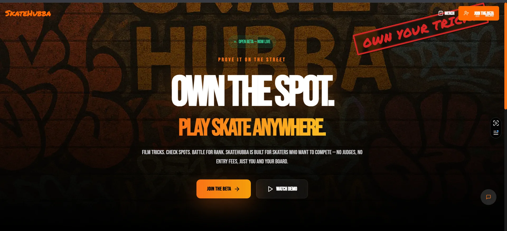
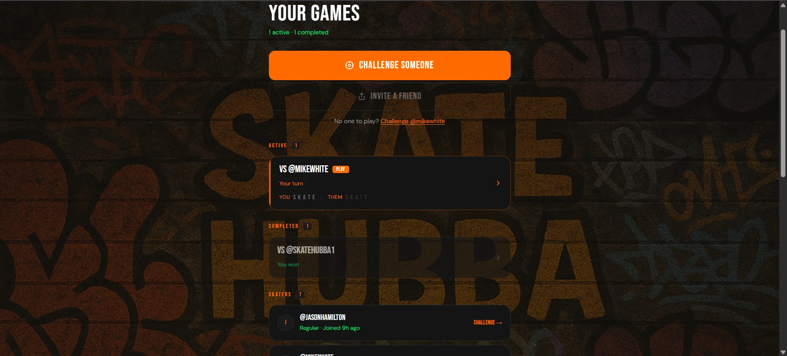
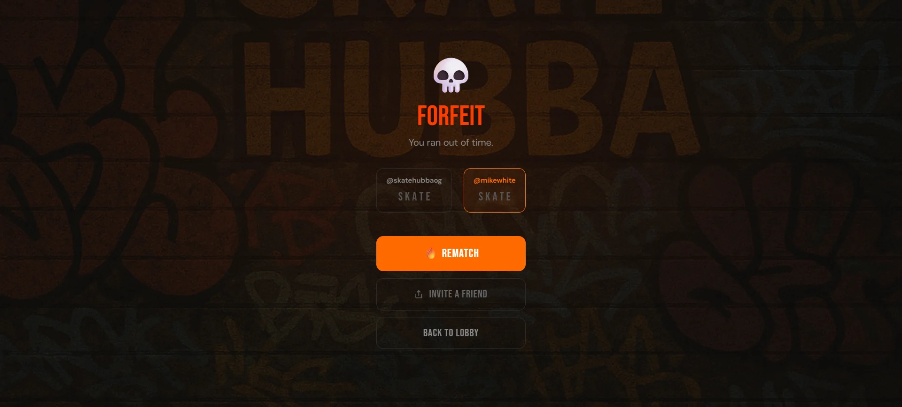

<div align="center">

<!-- GitHub dark mode: show white logo; light mode: show black logo -->
<picture>
  <source media="(prefers-color-scheme: dark)" srcset="docs/screenshots/logo-white.webp">
  <source media="(prefers-color-scheme: light)" srcset="docs/screenshots/logo-black.png">
  
</picture>

### Play S.K.A.T.E. For the love of the game.

An async multiplayer trick battle game for skateboarders.
Challenge friends, set tricks on video, and see if they can match you — one letter at a time.

[](https://skatehubba.com)
[](LICENSE)
[](CONTRIBUTING.md)

[](https://react.dev)
[](https://www.typescriptlang.org)
[](https://vite.dev)
[](https://firebase.google.com)
[](https://tailwindcss.com)

<br>


</div>

<br>

## What is S.K.A.T.E.?

S.K.A.T.E. is the skateboarding version of HORSE. One player sets a trick; the other must land it. Miss and you earn a letter — **S**, then **K**, then **A**, then **T**, then **E**. First to spell it out loses.

This app brings that to your phone, async. Set your trick whenever, opponent matches whenever. No need to be at the same spot or online at the same time.

> **Try it now:** [skatehubba.com](https://skatehubba.com) — sign up and start a game in under 30 seconds.

---

## Contents

[Screenshots](#screenshots) · [Tech Stack](#tech-stack) · [Features](#features) · [Quick Start](#quick-start) · [Scripts](#scripts) · [Project Structure](#project-structure) · [Environment Variables](#environment-variables) · [Documentation](#documentation) · [Deployment](#deployment) · [Traction](#traction) · [Analytics](#event-instrumentation--core-funnel) · [Roadmap](#roadmap-async-gameplay--network-effects) · [Credits](#credits) · [Contributing](#contributing)

---

## Screenshots

<div align="center">
<table>
<tr>
<td align="center"><strong>Landing Page</strong></td>
<td align="center"><strong>Your Games</strong></td>
<td align="center"><strong>Forfeit Screen</strong></td>
</tr>
<tr>
<td></td>
<td></td>
<td></td>
</tr>
</table>
</div>

---

## Tech Stack

| Layer     | Technology                                                        |
| --------- | ----------------------------------------------------------------- |
| Frontend  | React 19, TypeScript 5.6, Vite 8                                  |
| Styling   | Tailwind CSS 4 (dark theme, custom brand tokens)                  |
| Auth      | Firebase Auth: email, Google, Sign in with Apple; TOTP/SMS 2-step |
| Database  | Cloud Firestore (real-time, offline-capable)                      |
| Storage   | Firebase Storage (trick videos — WebM on web, MP4 on native)      |
| Native    | Capacitor 8 (iOS + Android); iOS builds are started by hand only  |
| Hosting   | Vercel (web + `api/` endpoints), Cloud Functions (gen 2, Blaze)   |
| Analytics | Vercel Analytics + PostHog (consent-gated via in-app banner)      |
| Errors    | Sentry                                                            |
| Testing   | Vitest, @testing-library/react, Playwright (E2E)                  |
| CI        | GitHub Actions                                                    |

No custom backend for core game logic: the client talks directly to Firebase, and Firestore rules enforce turn order, scores and rate limits. Server code is kept small and pinned by CI (`verify-no-cloud-functions` allowlist):

- **Cloud Functions** (`functions/src/`): stats close-out, Roll Dice (`dice/`), clip moderation (`moderation/`), `proBlessing` and pro tools triggers (`pro/`), the Closet economy (`closet/`), push delivery plus the 5-minute sweep that also calls the referee endpoints (`push/`), map check-ins and spot presence (`map/`), and admin analytics/announcements (`admin/`). Each is behind its own server switch, and all are deployed by hand; see [Deployment](#deployment).
- **`api/` serverless endpoints** on Vercel: the expired-turn and dispute referees (called by the `pushDispatchSweep` function), account deletion, `/player` social cards, and the Apple/Android app-link files.

---

## Features

### Gameplay

- **Async multiplayer** — players take turns on their own schedule, no live coordination needed
- **Video tricks** — one-take recording in-browser (WebM) or native app (MP4)
- **Real-time updates** — both players see state changes the moment they happen via Firestore snapshots
- **24-hour turn timer** — games don't stall; expired turns auto-forfeit
- **Optional referee** — nominate a neutral third player to rule on disputes and "Call BS" (off for new games behind `VITE_FEATURE_REFEREE_ENABLED`; disputes go to the community vote)
- **Binding community disputes** — on honor-system games a landed claim freezes the game for a 24 h accept/dispute window; a dispute goes to a binding community vote

### Identity & Trust

- **Email, Google and Sign in with Apple** — Google uses a popup with redirect fallback; Apple is on in iOS store builds and off on web/Android until `VITE_FEATURE_APPLE_SIGNIN_ENABLED=true`
- **Email verification** — required before play; resend from the app
- **Atomic username reservation** — no two players share a handle (Firestore transaction)
- **Block & report** — report a clip, comment, game or player; block from any profile, and blocked players disappear from your feed
- **Word filter** — slurs and hate terms are rejected in usernames, clip and spot comments, spot names and pro bios (`src/utils/objectionable.ts`); ordinary swearing is allowed
- **Clip moderation** — Video Intelligence screening on upload, community auto-hide and an admin keep/remove queue ([docs/CLIP_MODERATION.md](docs/CLIP_MODERATION.md); off until `MODERATION_ENABLED`)
- **Server-side game logic** — Firestore rules enforce turn order, scores, and rate limits — clients can't cheat
- **Two-step verification** — optional authenticator app (TOTP) or SMS second factor ([docs/MFA_TOTP.md](docs/MFA_TOTP.md))
- **Avatar upload with NSFW screening** — client-side moderation via nsfwjs before an avatar goes live
- **Age gating** — DOB collection with COPPA-compliant blocking for under-13 sign-ups
- **Data export & account deletion** — self-service JSON export and in-app deletion (`/data-deletion`, `api/account/delete.ts`); deleting an Apple-linked account revokes the Sign in with Apple token as App Store rules require

### Social & Discovery

- **Invite & share** — SMS, link copy, and native share for invites and trick clips
- **Push notifications** — FCM "your turn" alerts that deep-link into the game
- **Cross-game clips feed** — every landed trick rolls into a global, scrollable feed; the top slot autoplays muted with tap-to-unmute and rotates through visible clips
- **Clip upvotes** — single-tap, no-undo upvotes; one vote per user per clip enforced by rules, with a Top/New toggle over upvote-ranked results
- **Leaderboard** — ranked players by wins
- **Player profiles** — public per-user pages with full game history
- **Spots map** — geo-tagged skate spots with gnar rating + bust risk, filters, a nearby-spots dropdown (closest spots within 10 km), and challenge-from-spot
- **Map check-ins** _(testers only)_ — server-verified check-ins, a spot passport, legendary and seeded OpenStreetMap spots, crew-only and private spots ([docs/MAP_ROADMAP.md](docs/MAP_ROADMAP.md))
- **Spot presence** _(testers only)_ — "Challenge here" lists only skaters checked in at that spot, a day pass re-checks you in automatically within about 500 ft (you can turn it off) while the app is open, and online dots on avatars. The presence record never stores a location, only "at this spot until"
- **Spot chats** _(testers only)_ — a group chat per spot with report, block, word filter and rate limits
- **Achievements & badges** — earned badges (century club, streaks, OG, …) shown on profiles
- **Hubba Locker** — collectible locker items with a profile showcase (economy Phase A)
- **Closet** _(testers only)_ — earned and bought items, Drop Day, trading and Hubba Bucks, all server-authoritative. Includes the Mike White Signature collection with a 360 shoe viewer, and Closet Studio, a paint-style clothes editor that starts from Mike's designs ([docs/MIKE_WHITE_COLLECTION.md](docs/MIKE_WHITE_COLLECTION.md), [docs/CLOSET_STUDIO.md](docs/CLOSET_STUDIO.md))
- **Customizable profiles** _(testers only)_ — banner photo, theme colors, section order, pinned clips, links and a theme song ([docs/PROFILE_CUSTOM.md](docs/PROFILE_CUSTOM.md))
- **Verified Pro** — gold badge for professional skaters. Nobody can earn it: an existing pro has to bless you
- **Bless a pro** — a verified pro offers the badge with a public reason, the skater accepts, and the lineage ("Blessed by") shows on the profile. Limits: 2 per pro per 30 days, target account at least 30 days old ([docs/PRO_BLESSING.md](docs/PRO_BLESSING.md))
- **Pro profiles and `/pro` tools** — pro hero, bio, sponsors and signature tricks, edited by the pro on the Pro tools screen (public showcase behind `VITE_FEATURE_PRO_PROFILES`). Testers also get the Clip Reel and Pro Spots, a pro review queue, gold clip authoring, pro challenges, pro props and featured clips. Pro tools never carry admin powers
- **Admin console** — in-app moderation surface for bans, badge awards, and dispute oversight; testers also get user search, a disputes queue with an audit log, analytics and announcements (admin claim only)

### Extras (testers only)

- **Hesher tips** — Hesher, the SkateHubba mascot (formerly "Hubz"), shows one to three tip bubbles the first time you open each screen. Never while the camera is open. Settings has "Show tips" and "Replay tips"
- **Skate Runner** — an endless three-lane street grind game at `/play/runner` ([docs/RUNNER.md](docs/RUNNER.md)). Off for everyone except testers until it's signed off
- **Roll Dice**, **XP and levels**, **What's That Trick**, the **clip editor** and the **pro camera** — see [docs/FEATURE_FLAGS.md](docs/FEATURE_FLAGS.md)

### Platform

- **Native apps** — Capacitor builds for iOS and Android; iOS goes to TestFlight from a hand-started GitHub Actions or Xcode Cloud build ([docs/IOS_RELEASE.md](docs/IOS_RELEASE.md))
- **PWA-ready** — installable from the browser
- **Offline support** — Firestore local cache lets you read games without internet
- **Consent-gated analytics** — Vercel Analytics + PostHog behind an in-app consent banner, with full funnel instrumentation

---

## Quick Start

**Prerequisites:** Node ≥22 (`.nvmrc` pinned), npm 10+, a Firebase project with Auth + Firestore + Storage enabled.

```bash
git clone https://github.com/myhuemungusD/SkateHubba-play.git
cd SkateHubba-play
nvm use            # picks up Node 22 from .nvmrc
npm install
cp .env.example .env.local   # then fill in your Firebase config
npm run dev
```

Open [http://localhost:5173](http://localhost:5173).

For full setup including Firebase emulators, see [docs/DEVELOPMENT.md](docs/DEVELOPMENT.md).

---

## Scripts

| Command                           | Description                                                                                       |
| --------------------------------- | ------------------------------------------------------------------------------------------------- |
| `npm run dev`                     | Start the Vite dev server at `http://localhost:5173`                                              |
| `npm run build`                   | Type-check + production build → `dist/`                                                           |
| `npm run preview`                 | Preview the production build locally                                                              |
| `npm run typecheck`               | Run `tsc -b` only                                                                                 |
| `npm test`                        | Run the unit + component test suite once                                                          |
| `npm run test:watch`              | Run tests in watch mode                                                                           |
| `npm run test:coverage`           | Run tests with coverage report (CI gate)                                                          |
| `npm run check:coverage-per-file` | Fail when a file drops below its per-file coverage floor                                          |
| `npm run test:rules`              | Run Firestore security-rules tests against the rules emulator                                     |
| `npm run test:e2e`                | Run Playwright E2E tests (auto-starts emulators)                                                  |
| `npm run test:e2e:ui`             | Same as above in the Playwright UI runner                                                         |
| `npm run lint`                    | Lint `src/`, `api/`, `e2e/`, and `public/sw-cleanup.js` with ESLint                               |
| `npm run lint:fix`                | Lint and auto-fix where possible                                                                  |
| `npm run format`                  | Format `src/**/*.{ts,tsx}` with Prettier                                                          |
| `npm run check:test-dup`          | Flag duplicated test cases (CI gate)                                                              |
| `npm run check:file-length`       | Fail on any file over its LOC budget (blocking in the PR gate)                                    |
| `npm run verify`                  | Full CI gate: type-check, lint, coverage, build, test-dup                                         |
| `npm run emulators`               | Start the Firebase emulator suite locally                                                         |
| `npm run cap:sync`                | Sync the web build into iOS/Android Capacitor projects                                            |
| `npm run cap:open:ios`            | Open the iOS project in Xcode                                                                     |
| `npm run cap:open:android`        | Open the Android project in Android Studio                                                        |
| `npm run cap:run:ios`             | Build and run the app on an iOS device/simulator                                                  |
| `npm run cap:run:android`         | Build and run the app on an Android device/emulator                                               |
| `npm run testers:sync`            | Match every server `*_TESTER_UIDS` list to `config/featureTesters` (dry run; `-- --apply` writes) |
| `npm run check:testers`           | Fail if code has a `*_TESTER_UIDS` list that `testers:sync` doesn't know (PR gate)                |
| `npm run ios:preflight`           | Free Linux check of the iOS native patches before a paid Mac build                                |
| `npm run deploy:functions`        | One-command Cloud Functions deploy (checks first; `-- --only a,b`, `-- --dry-run`)                |
| `npm run deploy:rules`            | One-command Firestore + Storage rules deploy                                                      |
| `npm run deploy:all`              | Functions and rules together                                                                      |
| `npm run review:seed`             | Create or reset the App Review / Play demo account with real-looking content                      |
| `npm run review:screenshots`      | Take store screenshots at every required size                                                     |

---

## Project Structure

```
skatehubba-play/
├── public/                    # Static assets served at /
├── src/
│   ├── App.tsx                # Router + top-level providers (Auth/Game/Navigation)
│   ├── main.tsx               # React entry + Sentry init
│   ├── firebase.ts            # Firebase init (named database "skatehubba")
│   ├── index.css              # Tailwind v4 @theme + custom animations
│   ├── components/            # Reusable UI (VideoRecorder, Leaderboard, ClipsFeed, …)
│   │   └── map/               # Spots map UI (SpotMap, AddSpotSheet, BustRisk, …)
│   ├── screens/               # Full-page components (Lobby, GamePlay, MapPage, …)
│   ├── context/               # AuthContext, GameContext, NavigationContext, NotificationContext, OnboardingContext
│   ├── hooks/                 # Key hooks — useAuth, useOnlineStatus, usePlayerProfile, useBlockedUsers, …
│   ├── services/              # Single entry point for all Firebase calls, split by domain
│   │   ├── auth.ts            #   sign up / sign in / Google + Apple / password reset (+ auth.appleRevoke.ts)
│   │   ├── users.ts           #   profiles + atomic username reservation
│   │   ├── games.*.ts         #   game domain — games.ts is a barrel over create/match/judge/turns/mappers/subscriptions
│   │   ├── disputes.*.ts      #   referee + community dispute system (raise, votes, feed, resolution, cascade)
│   │   ├── clips.*.ts         #   landed-trick clips feed, upvotes, comments, user uploads
│   │   ├── spots.ts           #   skate spots (geo-tagged map)
│   │   ├── storage.ts         #   video upload (WebM/MP4, 1KB–50MB, retry)
│   │   ├── notifications.ts   #   in-app notifications; fcm.ts / pushDispatch.ts for push delivery
│   │   ├── achievements.ts    #   badge economy (with locker.ts — Hubba Locker showcase)
│   │   ├── admin.ts           #   admin console ops (+ admin.bans.ts)
│   │   ├── mfa.ts             #   TOTP / SMS two-step enrollment and sign-in
│   │   ├── proBlessing.ts     #   bless / accept / decline / admin revoke via the proBlessing function
│   │   ├── avatars.ts         #   avatar upload (+ avatarModeration.ts NSFW screening)
│   │   ├── blocking.ts        #   block / unblock users
│   │   ├── reports.ts         #   user + content reports
│   │   ├── userData.ts        #   GDPR data export / account-deletion cascade
│   │   └── analytics.ts       #   consent-gated event wrapper (Vercel Analytics + PostHog)
│   ├── constants/             # Shared constants (badges, trick categories, stats, UI, video)
│   ├── lib/                   # Third-party bridges (Sentry, Mapbox, PostHog, consent)
│   ├── utils/                 # Helpers, retry logic, error parsing
│   └── types/                 # Shared TypeScript types
├── api/                       # Vercel serverless endpoints (cron sweeps, push drain, account deletion, social cards)
├── functions/                 # Cloud Functions: stats close-out, dice/, moderation/, pro/ (CI-pinned)
├── ios/ · android/            # Capacitor native projects (ios/App/App/PrivacyInfo.xcprivacy = privacy manifest)
├── fastlane/                  # iOS/Android signing, TestFlight upload, store listing copy (fastlane/metadata)
├── e2e/                       # Playwright E2E specs (auth, game, forfeit, invite, map, clips, onboarding, offline, …)
├── rules-tests/               # Firestore + Storage rules tests incl. red-team suites
├── docs/                      # Documentation suite
│   └── screenshots/           # README images + brand assets
├── firestore.rules            # Firestore security rules (turn order, scores, rate limits)
├── storage.rules              # Storage security rules (auth, size, content-type)
├── .env.example               # Environment variable template
└── vercel.json                # CSP headers, HSTS, SPA rewrites, domain redirects
```

---

## Environment Variables

Copy `.env.example` to `.env.local` and fill in the values. The full template (with comments and source-of-truth links) lives in [`.env.example`](.env.example).

**Required**

| Variable                            | Source                                                          |
| ----------------------------------- | --------------------------------------------------------------- |
| `VITE_FIREBASE_API_KEY`             | Firebase Console → Project Settings → General → Your Apps       |
| `VITE_FIREBASE_AUTH_DOMAIN`         | "                                                               |
| `VITE_FIREBASE_PROJECT_ID`          | "                                                               |
| `VITE_FIREBASE_STORAGE_BUCKET`      | "                                                               |
| `VITE_FIREBASE_MESSAGING_SENDER_ID` | "                                                               |
| `VITE_FIREBASE_APP_ID`              | "                                                               |
| `VITE_MAPBOX_TOKEN`                 | Mapbox Dashboard → Access Tokens (required for the `/map` page) |

**Optional (recommended in production)**

| Variable                       | Purpose                                                                      |
| ------------------------------ | ---------------------------------------------------------------------------- |
| `VITE_FIREBASE_MEASUREMENT_ID` | Firebase Analytics                                                           |
| `VITE_FIREBASE_VAPID_KEY`      | FCM web push (Firebase Console → Cloud Messaging → Web Push certificates)    |
| `VITE_RECAPTCHA_SITE_KEY`      | App Check via reCAPTCHA v3 (blocks bot/API-abuse traffic)                    |
| `VITE_APPCHECK_ENABLED`        | App Check master switch; set to `true` to activate alongside the site key    |
| `VITE_SENTRY_DSN`              | Sentry error tracking; without it, errors only appear in the browser console |
| `VITE_POSTHOG_KEY`             | PostHog product analytics; consent-gated, omit to disable                    |
| `VITE_POSTHOG_HOST`            | PostHog ingestion host; defaults to the US cloud when unset                  |
| `VITE_APP_URL`                 | Production domain for Firebase email action links + invite URLs              |
| `VITE_MAPBOX_STYLE_URL`        | Custom Mapbox Studio style; falls back to `mapbox://styles/mapbox/dark-v11`  |
| `VITE_USE_EMULATORS=true`      | Local-only — point the client at the Firebase emulator suite                 |
| `VITE_FEATURE_*`               | Feature flags, all off by default (see below)                                |

**Feature flags.** Every feature flag defaults to **off**: only the literal string `true` turns one on, and `VITE_*` values are baked in at build time, so a change needs a redeploy or a new app build. Testers listed in the Firestore doc `config/featureTesters` (Jason and Mike) get every flag on through a runtime override. The full list, what each flag shows, its server switch and where it is on today live in [docs/FEATURE_FLAGS.md](docs/FEATURE_FLAGS.md).

The website's flags are set in the Vercel project, not in this repo; [docs/FEATURE_FLAGS.md](docs/FEATURE_FLAGS.md) lists what is on there. `VITE_FEATURE_EXTRAS_ENABLED` turns on the Map, Clips feed and Verified Pro. The launch freeze was lifted on 2026-10-10. A local build or fork without it falls back to the core game loop: those routes redirect to `/lobby` (signed in) or `/` (signed out). iPhone builds turn on `VITE_FEATURE_EXTRAS_ENABLED`, `VITE_FEATURE_APPLE_SIGNIN_ENABLED` and `VITE_FEATURE_PRO_PROFILES` (plus the pro showcase, calls, community and camera flags) and leave `VITE_FEATURE_PRO_BLESSING`, Dice and the Closet off. See `.github/workflows/ios-release.yml` and `ios/App/ci_scripts/ci_post_clone.sh` for the exact set.

Server-side switches for the Cloud Functions (`MAP_*`, `SPOT_PRESENCE_*`, `XP_*`, `DICE_*`, `CLOSET_*`, `MODERATION_ENABLED`, `PRO_BLESSING_*`) live in the functions parameter file; see [docs/DEPLOY_FUNCTIONS.md](docs/DEPLOY_FUNCTIONS.md).

**Server-only (Vercel project env, never `VITE_`-prefixed — see `.env.example`)**

| Variable                        | Purpose                                                                              |
| ------------------------------- | ------------------------------------------------------------------------------------ |
| `CRON_SECRET`                   | Bearer token the `pushDispatchSweep` function presents to the `api/cron/*` endpoints |
| `FIREBASE_SERVICE_ACCOUNT_JSON` | Admin SDK credentials for the serverless endpoints (cron sweeps, account deletion)   |

---

## Documentation

| Document                                                       | Description                                  |
| -------------------------------------------------------------- | -------------------------------------------- |
| [docs/DEVELOPMENT.md](docs/DEVELOPMENT.md)                     | Local setup, emulators, dev workflow         |
| [docs/FEATURE_FLAGS.md](docs/FEATURE_FLAGS.md)                 | Every flag, testers override, testers:sync   |
| [docs/DEPLOYMENT.md](docs/DEPLOYMENT.md)                       | Production deploy to Vercel + Firebase       |
| [docs/ARCHITECTURE.md](docs/ARCHITECTURE.md)                   | System design, data flow, decisions          |
| [docs/DATABASE.md](docs/DATABASE.md)                           | Firestore schema and security rules          |
| [docs/API.md](docs/API.md)                                     | Service layer function reference             |
| [docs/TESTING.md](docs/TESTING.md)                             | Test suite overview and how to run           |
| [docs/GAME_MECHANICS.md](docs/GAME_MECHANICS.md)               | Game rules and turn flow                     |
| [docs/GAME_STATE_MACHINE.md](docs/GAME_STATE_MACHINE.md)       | State transitions and lifecycle              |
| [docs/STATUS_REPORT.md](docs/STATUS_REPORT.md)                 | Per-feature completion status                |
| [docs/DECISIONS.md](docs/DECISIONS.md)                         | Architecture decision records                |
| [docs/CHARTER.md](docs/CHARTER.md)                             | Operating charter — architectural boundaries |
| [docs/GAPS.md](docs/GAPS.md)                                   | Prioritized risk register (P0–P3)            |
| [ROADMAP.md](ROADMAP.md)                                       | Direction, exit criteria, and the icebox     |
| [docs/ECONOMY.md](docs/ECONOMY.md)                             | Long-term economy and creator ecosystem      |
| [docs/PRO_BLESSING.md](docs/PRO_BLESSING.md)                   | Bless a pro: rules, limits, flags            |
| [docs/MFA_TOTP.md](docs/MFA_TOTP.md)                           | Two-step verification (TOTP / SMS)           |
| [docs/CLIP_MODERATION.md](docs/CLIP_MODERATION.md)             | Clip moderation pipeline                     |
| [docs/DICE.md](docs/DICE.md)                                   | Roll Dice (server-rolled, off)               |
| [docs/DEPLOY_FUNCTIONS.md](docs/DEPLOY_FUNCTIONS.md)           | Cloud Functions deploy + parameter secret    |
| [docs/IOS_RELEASE.md](docs/IOS_RELEASE.md)                     | iOS signing, TestFlight, App Store release   |
| [docs/XCODE_CLOUD.md](docs/XCODE_CLOUD.md)                     | iOS builds on Xcode Cloud                    |
| [docs/STORE_REVIEW_KIT.md](docs/STORE_REVIEW_KIT.md)           | Demo reviewer account + store screenshots    |
| [docs/MAP_ROADMAP.md](docs/MAP_ROADMAP.md)                     | Map check-ins, spot presence, map roadmap    |
| [docs/RUNNER.md](docs/RUNNER.md)                               | Skate Runner (testers only)                  |
| [docs/MIKE_WHITE_COLLECTION.md](docs/MIKE_WHITE_COLLECTION.md) | Mike White Signature collection + credit     |
| [docs/CLOSET_STUDIO.md](docs/CLOSET_STUDIO.md)                 | Closet Studio clothes editor                 |
| [docs/STORE_PRIVACY_ANSWERS.md](docs/STORE_PRIVACY_ANSWERS.md) | App Privacy / Data safety answers            |
| [CONTRIBUTING.md](CONTRIBUTING.md)                             | How to contribute                            |
| [SECURITY.md](SECURITY.md)                                     | Security policy and vulnerability reporting  |
| [CHANGELOG.md](CHANGELOG.md)                                   | Version history                              |

---

## Deployment

See [docs/DEPLOYMENT.md](docs/DEPLOYMENT.md) for the full guide. Short version:

1. **Web:** merging to `main` deploys to Vercel (env vars live in the Vercel project). Finished work is merged in batches, about once a day, so each batch costs one production build.
2. **Rules:** the _Deploy Firebase Rules_ workflow ships `firestore.rules` / `storage.rules` after merge. From a logged-in PC, `npm run deploy:rules` does the same with checks first.
3. **Cloud Functions:** never automatic. Run `npm run deploy:functions` from a logged-in PC, or _Deploy Firebase Functions_ by hand (`gh workflow run firebase-functions-deploy.yml --ref main -f confirm=deploy`). Every parameter needs a value ([docs/DEPLOY_FUNCTIONS.md](docs/DEPLOY_FUNCTIONS.md)). A brand-new function needs a one-time stub first.
4. **iOS:** never automatic, and no merge starts a Mac build. Run `npm run ios:preflight`, then start _iOS TestFlight_ (`ios-release.yml`) by hand or an Xcode Cloud build. Each Mac build costs money, so builds are batched and infrequent ([docs/IOS_RELEASE.md](docs/IOS_RELEASE.md)). Publishing a GitHub release or pushing a `v*` tag runs the unsigned `ios-build.yml` check, so don't merge the release-please PR casually.

---

## Traction

| Metric                | Status                                                                                                                                              |
| --------------------- | --------------------------------------------------------------------------------------------------------------------------------------------------- |
| Live at               | [skatehubba.com](https://skatehubba.com)                                                                                                            |
| Auth methods          | Email/password, Google, Sign in with Apple (iOS); optional TOTP/SMS 2-step                                                                          |
| Real-time multiplayer | Firestore `onSnapshot` — sub-second updates                                                                                                         |
| Video infrastructure  | WebM (web) + MP4 (native), 1 KB – 50 MB per clip, retry w/ backoff                                                                                  |
| Turn timer            | 24 h per turn, server-validated forfeit                                                                                                             |
| Native apps           | Capacitor builds for iOS + Android; iOS on TestFlight (builds started by hand)                                                                      |
| CI pipeline           | Lint → type-check → unit tests + coverage → build → Lighthouse → E2E                                                                                |
| Test coverage         | 100% on `src/services/**` and `src/hooks/**` (enforced by CI thresholds)                                                                            |
| Rules tests           | `@firebase/rules-unit-testing` against the Firestore emulator                                                                                       |
| Security posture      | App Check (reCAPTCHA v3), CSP/HSTS, Firestore rules enforce game logic                                                                              |
| Bundle size (gzip)    | ~401 kB first load incl. CSS (Firebase ~213 kB, React ~68 kB, app ~64 kB), measured 2026-10-01 — Mapbox, nsfwjs, and non-critical screens lazy-load |

---

## Event Instrumentation & Core Funnel

All analytics flow through a single wrapper (`src/services/analytics.ts`) that fans each event out to [Vercel Analytics](https://vercel.com/docs/analytics) and [PostHog](https://posthog.com) (`src/lib/posthog.ts`). Both are gated on user consent (`isAnalyticsAllowed()` in `src/lib/consent.ts`, collected by the in-app consent banner); PostHog only activates when `VITE_POSTHOG_KEY` is set. Swapping providers is a one-file change.

### Instrumented Events

| Event                                              | Fires When                                     | Properties                                                   |
| -------------------------------------------------- | ---------------------------------------------- | ------------------------------------------------------------ |
| `sign_up`                                          | New account created                            | `method` (email / google)                                    |
| `sign_in`                                          | User logs in                                   | `method` (email / google)                                    |
| `game_created`                                     | Player creates a new challenge                 | `gameId`                                                     |
| `trick_set`                                        | Setter records and submits a trick             | `gameId`, `trickName`                                        |
| `match_submitted`                                  | Matcher submits their attempt                  | `gameId`, `landed` (bool)                                    |
| `game_completed`                                   | Game reaches a final state (win/loss)          | `gameId`, `won` (bool)                                       |
| `video_uploaded`                                   | Trick video successfully uploaded              | `durationMs`, `sizeBytes`                                    |
| `invite_sent`                                      | Player shares an invite link                   | `method` (sms / copy / share)                                |
| `clip_shared`                                      | Player shares a trick clip                     | `method`, `context`                                          |
| `clip_saved`                                       | Player saves a trick clip locally              | `context`                                                    |
| `game_shared`                                      | Player shares a completed game                 | `context`, `method`                                          |
| `map_viewed`                                       | Spots map screen mounts                        | —                                                            |
| `spot_previewed`                                   | User taps a spot marker → preview opens        | `spotId`                                                     |
| `challenge_from_spot`                              | Challenge screen opened with `?spot=` ref      | `spotId`                                                     |
| `sign_in_attempt` / `sign_up_attempt`              | Auth form submitted (success-rate denominator) | `method`                                                     |
| `sign_in_failure` / `sign_up_failure`              | Auth attempt rejected                          | `method`, `code`                                             |
| `install_prompt_answered`                          | User answers the Chromium install dialog       | `outcome` (accepted / dismissed)                             |
| `app_installed`                                    | Browser fires `appinstalled`                   | —                                                            |
| `landing_map_viewed`                               | Not fired: landing map teaser removed (#599)   | —                                                            |
| `landing_pin_clicked`                              | Not fired: landing map teaser removed (#599)   | `spotId`                                                     |
| `profile_viewed`                                   | Player profile screen mounts                   | hashed `viewerUid` / `profileUid`, `isOwn`, `msToFirstPaint` |
| `profile_stat_tile_tapped`                         | Stat tile tapped on a profile                  | `statName`, hashed `profileUid`                              |
| `avatar_upload_started` / `_completed` / `_failed` | Avatar upload pipeline stages                  | `source`, sizes, `nsfwScore`, `errorCode`                    |

### Core Funnel

```
sign_up → game_created → trick_set → match_submitted → game_completed
              ▲                              ↓
              │                       invite_sent (viral loop)
              │                              ↓
              │                       clip_shared (content flywheel)
              │
   map_viewed → spot_previewed → challenge_from_spot
                       (spot-driven acquisition path)
```

Each step maps 1:1 to a tracked event. Drop-off between any two stages is visible in the Vercel Analytics dashboard.

---

## Roadmap: Async Gameplay → Network Effects

For the live, evidence-backed completion table, see [docs/STATUS_REPORT.md](docs/STATUS_REPORT.md). For direction, exit criteria, and what's deliberately parked, see [ROADMAP.md](ROADMAP.md).

> **Legend:** ✅ shipped · 🚧 in progress · 🧑‍⚖️ in review · 🧊 deferred · ⏳ planned

### Phase 1 — Core Loop ✅ shipped

- Async S.K.A.T.E. gameplay with video proof
- Email, Google and Apple sign-in with verification
- Real-time game state via Firestore snapshots
- 24-hour turn timer with auto-forfeit
- Player profiles with game history

### Phase 2 — Viral Mechanics ✅ shipped

- **Invite flow** — SMS/link/native share to pull friends in (instrumented: `invite_sent`)
- **Clip sharing** — share trick clips to social platforms (instrumented: `clip_shared`)
- **Rematch** — one-tap rematch at game over to keep engagement loops tight
- **Push notifications** — FCM "Your turn" alerts with deep-link into the game

### Phase 3 — Social Graph & Discovery 🟢 mostly shipped

- ✅ **Leaderboard** — ranked players by wins, creating aspirational targets
- ✅ **Player profiles** — public game archives that double as social proof
- ✅ **Challenge anyone** — search/invite by username, expanding beyond existing friend groups
- ✅ **Block & report** — moderation tooling backed by Firestore rules
- ✅ **Cross-game clips feed** — landed tricks become a discovery surface with an autoplaying top-slot that rotates through the visible clips
- ✅ **Clip upvotes** — single-tap, no-undo upvotes on every clip (per-vote rules + double-vote guard)
- ✅ **Vote-driven clip ranking** — feed defaults to upvote-ranked with a Top/New toggle and a fallback to chronological if the composite index is missing
- 🧊 **Spectator mode** — deferred; eligible for revisit now that ranked clips produce engagement data

### Phase 4 — Network Effects Flywheel 🟡 in progress

- ✅ **Spot tagging** — geo-tagged skate spots with gnar rating + bust risk, full CRUD, Firestore rules, and security-rule tests
- ✅ **Spot map UI** — Mapbox GL integration with markers, filters (gnar/bust risk), spot preview cards, and add-spot sheet
- ✅ **Spot ↔ game linkage** — challenge from any spot detail page or map preview; `?spot=` query param flows through to the game doc
- ✅ **Bottom tab bar** — persistent Home · Clips · Challenge · Map · Me navigation, with Challenge as the raised centre action
- ✅ **Nearby spots** — focusing the empty map search lists the closest active spots within 10 km of your GPS fix
- 🚧 **Custom Mapbox style** — branded dark-base map style via Mapbox Studio ([#191](https://github.com/myhuemungusD/SkateHubba-play/issues/191))
- ⏳ **Crew challenges** — team-based S.K.A.T.E. (3v3) multiplies each invite by 6 players
- ⏳ **Trick library** — community trick index with video proof, a defensible content layer
- ⏳ **Tournaments** — bracket-style competitions for appointment engagement

### Referee System ✅ — shipped in v1.1.0

Optional third player who arbitrates disputes. Shipped 2026-04-19 — see the `[1.1.0]` entries in [CHANGELOG.md](CHANGELOG.md).

- Nominate a referee at challenge time; honor system runs by default if declined or absent
- **Dispute path** — referee rules on a matcher's "landed" claim (24 h, then auto-accept)
- **Call BS path** — matcher can flag the setter's video before attempting (24 h, then set stands)
- New `setReview` phase + `judgeId` / `judgeStatus` / `judgeReviewFor` schema fields (internal names preserved to avoid a migration for in-flight games)
- Honor-system games skip the `disputable` phase entirely; they use the binding community-dispute path instead (`pendingReview` → `communityReview`), documented in [docs/DISPUTE_BINDING_DESIGN.md](docs/DISPUTE_BINDING_DESIGN.md)

**The thesis:** Each game produces shareable video content. Each shared clip is a free acquisition channel. Each new player brings their crew. The game mechanic (asynchronous, video-first) removes the coordination cost that kills most multiplayer apps — you don't need to be online at the same time or at the same spot.

---

## Credits

- **Mike White** designed the Mike White Signature collection (every signature shoe, drawn by hand) and the Closet Studio starter templates. The app shows "Designed by Mike White" on his items and "Based on a Mike White design" on anything made from them ([docs/MIKE_WHITE_COLLECTION.md](docs/MIKE_WHITE_COLLECTION.md)).
- Skate sounds and Skate Runner models carry their own licenses: [public/editor/CREDITS.md](public/editor/CREDITS.md) and [docs/RUNNER_ASSETS.md](docs/RUNNER_ASSETS.md).

---

## Contributing

See [CONTRIBUTING.md](CONTRIBUTING.md).

---

<div align="center">

<picture>
  <source media="(prefers-color-scheme: dark)" srcset="docs/screenshots/logo-white.webp">
  <source media="(prefers-color-scheme: light)" srcset="docs/screenshots/logo-black.png">
  
</picture>

**Built for skaters, by skaters.**

[skatehubba.com](https://skatehubba.com)

[MIT License](LICENSE)

</div>
