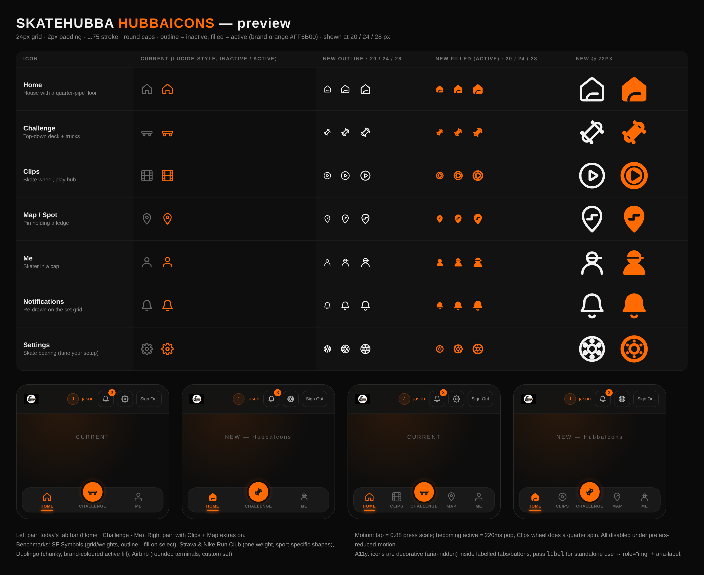

# Icon inventory & HubbaIcons

Preview: 

## Libraries in use
- **HubbaIcons** (new, `src/components/hubbaIcons`): tab bar + header (Home, Clips, Challenge, Map, Me, Bell, Settings).
- **In-house SvgIcon set** (`src/components/icons.tsx`, `icons.camera.tsx`, `iconBase.tsx`): lucide/feather-style 24px, 1.8 stroke.
- **lucide-react** ^1.55: admin, map, pro, locker, badges.
- **Inline one-off SVGs**: brand buttons (Apple/Google), mascot, share, clip actions, pull-to-refresh, etc. Camera crosshair (TargetIcon / map Crosshair) is intentionally untouched.

## In-house SvgIcon exports
- TargetIcon
- FilmIcon
- VideoIcon
- ClockIcon
- HourglassIcon
- XCircleIcon
- SkullIcon
- FlameIcon
- ThumbsUpIcon
- ThumbsDownIcon
- GavelIcon
- TrophyIcon
- ShieldIcon
- FlagIcon
- UsersIcon
- SkateboardIcon
- ChevronRightIcon
- ChevronLeftIcon
- HomeIcon
- MapPinIcon
- UserIcon
- CameraIcon
- RecordIcon
- StopIcon
- PlayIcon
- ReplayIcon
- FisheyeIcon
- FlipCameraIcon

## lucide-react imports by file
- `src/screens/SpotDetailPage.tsx`: ChevronLeft, MapPin, Send
- `src/screens/ProToolsScreen/index.tsx`: ArrowLeft
- `src/screens/PlayerProfileScreen/components/ProShowcase.tsx`: Film, MapPin, Swords, Wrench
- `src/screens/AdminScreen/index.tsx`: ChevronLeft, ShieldCheck
- `src/screens/AdminScreen/components/VerifyProPanel.tsx`: BadgeCheck, ShieldOff
- `src/screens/AdminScreen/components/UserLookupForm.tsx`: Search
- `src/screens/AdminScreen/components/ReportsPanel.tsx`: RefreshCw
- `src/screens/AdminScreen/components/ClipReviewPanel.tsx`: RefreshCw
- `src/screens/AdminScreen/components/AdminRoadmapPanel.tsx`: BarChart3, Ban, FileClock, Flag, Megaphone, Scale, Users
- `src/constants/badges.ts`: Crown, Flame, MapPin, Medal, Trophy
- `src/components/ui/PasswordToggle.tsx`: Eye, EyeOff
- `src/components/pro/proTools.tsx`: Award, Gavel, Sparkles, Star, Swords, UserCog
- `src/components/pro/BlessingHero.tsx`: Sparkles
- `src/components/pro/BlessProButton.tsx`: Sparkles, X
- `src/components/map/GnarRating.tsx`: Flame
- `src/components/map/BustRisk.tsx`: ShieldAlert
- `src/components/map/AddSpotSheet.tsx`: X, ChevronLeft
- `src/components/map/AddSpotPhotosStep.tsx`: X
- `src/components/ClosetShowcase.tsx`: ChevronRight
- `src/components/map/SpotPreviewCard.tsx`: X, Navigation, BadgeCheck, ImageOff, Flag
- `src/components/map/SpotMapOverlays.tsx`: MapPinOff, X
- `src/components/map/SpotFilterPanel.tsx`: BadgeCheck
- `src/components/map/SpotFilterBar.tsx`: Search, SlidersHorizontal, X
- `src/components/map/SpotMap.tsx`: Crosshair, Plus
- `src/components/map/NearbySpotsList.tsx`: MapPin, BadgeCheck

## Files with inline <svg>
- `src/components/hubbaIcons/HubbaIcon.tsx`
- `src/components/hubbaIcons/glyphs.ts`
- `src/screens/LandingFooter.tsx`
- `src/screens/Landing.tsx`
- `src/components/waiting/ClipShareButtons.tsx`
- `src/screens/PlayerProfileScreen/components/ProfileIdentityCard.tsx`
- `src/screens/PlayerProfileScreen/components/AchievementsRibbon.tsx`
- `src/components/onboarding/MascotBubble.tsx`
- `src/components/map/LandingMap.tsx`
- `src/screens/Lobby/components/EmptyLobbyState.tsx`
- `src/components/iconBase.tsx`
- `src/components/InviteButton.tsx`
- `src/components/GoogleButton.tsx`
- `src/components/AppleButton.tsx`
- `src/components/SkateButton.tsx`
- `src/components/PullToRefreshIndicator.tsx`
- `src/components/ClipsFeed/SpotlightVideo.tsx`
- `src/components/NotificationRow.tsx`
- `src/components/NotificationBellIcons.tsx`
- `src/components/ClipsFeed/ClipActions.tsx`
